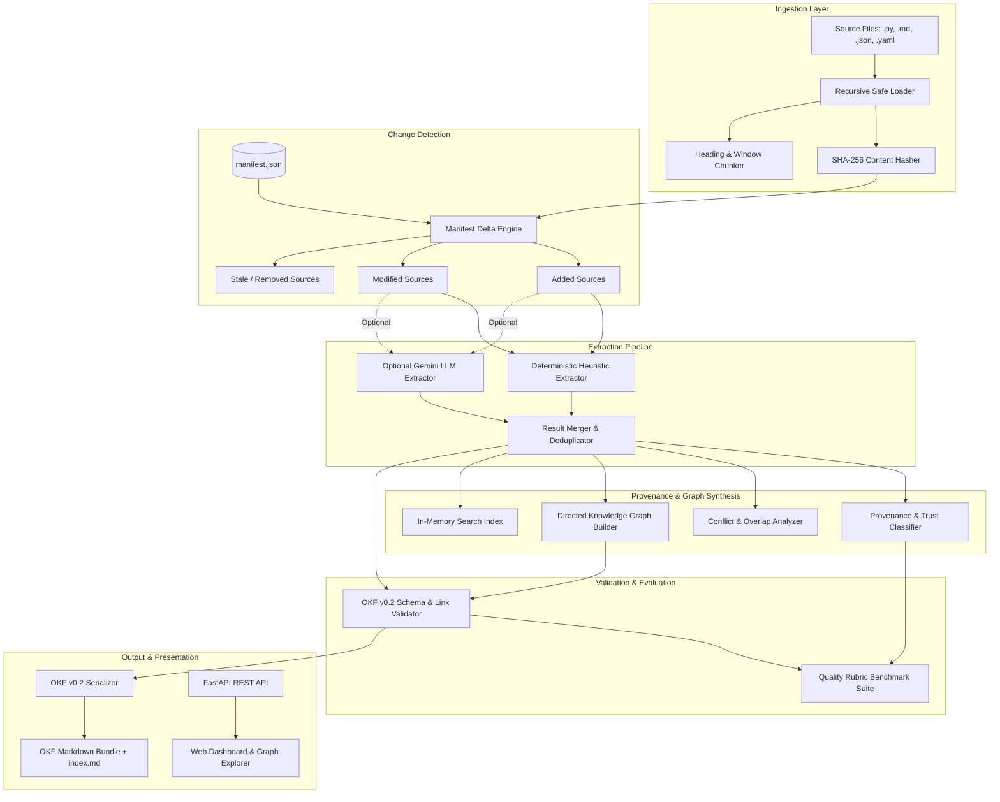

# KnowledgeSmith AI — System Architecture

## 1. Overview & Vision

**KnowledgeSmith AI** is an autonomous knowledge engineering platform designed to inspect unstructured and semi-structured technical repositories (codebases, architectural specifications, markdown documentation, configuration files) and translate them into a standardized, interconnected, and verifiable knowledge corpus adhering to Google's **Open Knowledge Format (OKF) v0.2**.

Unlike basic Retrieval-Augmented Generation (RAG) chunkers or naive vector databases, KnowledgeSmith AI operates on structured concepts, explicit relationships, provenance tracking, trust tiers, and graph topology.

---

## 2. High-Level Architecture Diagram

---

## 3. Subsystem Breakdown

### 3.1 Ingestion Layer (`backend/app/ingestion`)
- **Safety & Boundary Protection**: Prevents path-traversal and symlink escape vulnerabilities via `_resolve_and_check_root` and `real.relative_to(resolved_root)`.
- **Deterministic Identification**: Each source file receives a 16-character stable identifier computed via normalized, lowercase relative paths.
- **Content Hashing**: SHA-256 content hashes are calculated at ingestion time to guarantee exact cryptographic verification for subsequent change detection.

### 3.2 Incremental Change Detection (`backend/app/knowledge/change_detector.py`)
- Knowledge bases degrade over time if files are continuously deleted or modified without tracking.
- The platform maintains a persistent `manifest.json`.
- When sources change:
  - **Added files**: New concepts and relationships are extracted.
  - **Modified files**: Provenance records and claims referencing the previous hash are flagged as stale and re-extracted.
  - **Removed files**: Artifacts are **not** blindly deleted; instead, they are marked with `status: stale` to preserve historical lineage without corrupting downstream links.

### 3.3 Extraction Architecture (`backend/app/extraction`)
- **Deterministic Phase (Offline & Reproducible)**:
  - Scans Python files for Class declarations, Function signatures, docstrings, and import graphs.
  - Scans Markdown files for hierarchical sections (`H1`–`H6`) and extractable assertions.
  - Scans structured JSON/YAML keys.
  - Default trust tier: `unverified` with line-level evidence references (`start_line`, `end_line`, `snippet`).
- **LLM Semantic Phase (Google Gemini)**:
  - Optional adapter using `google-generativeai`.
  - Prompts enforce structured JSON schema adherence.
  - All LLM-generated assertions are tagged with `ExtractionMethod.LLM` and strictly isolated from raw source facts to prevent hallucination contamination.

### 3.4 Knowledge Graph Topology (`backend/app/knowledge/graph.py`)
- Implemented as an in-memory directed graph using Python native adjacency tables for zero external dependency overhead:
  - Outgoing edges: `_outgoing[source_id] -> [GraphEdge]`
  - Incoming edges: `_incoming[target_id] -> [GraphEdge]`
- **Capabilities**:
  - Direct neighbors query.
  - Reverse neighbor lookup (e.g. "what concepts depend on this class?").
  - Multi-hop Breadth-First Search (BFS) discovery.
  - Missing-target / dangling reference detection.
  - Graph density, orphan node ratio, and JSON export.

### 3.5 Provenance & Trust Modeling (`backend/app/knowledge/provenance.py`)
- Follows the OKF v0.2 trust specification (§5.3).
- Trust tiers:
  1. `human_reviewed`: Verified by a human auditor.
  2. `machine_confirmed`: Deterministically verified against active source code lines and hashes.
  3. `unverified`: Default state for heuristic and LLM extractions.
- Retains exact source file path, source ID, content SHA-256, line ranges, and extraction timestamps.

### 3.6 OKF v0.2 Serialization (`backend/app/knowledge/okf_serializer.py`)
- Emits portable, human-readable Markdown files with YAML frontmatter:
  - Required: `type` (e.g., `Class`, `Module`, `Section`, `Document`, `API`).
  - Recommended: `title`, `description`, `tags`, `resource`.
  - Provenance: `sources` list with per-source credibility indicators, `generated` actor and timestamp.
  - Lifecycle: `status` (`active`, `stale`, `deprecated`).
- Auto-generates progressive disclosure `index.md` files enabling hierarchical agent or human navigation.

### 3.7 Evaluation & Benchmark Engine (`backend/app/evaluation`)
- Quantitative metrics calculation:
  - Concept coverage (concepts / file).
  - Claim density (claims / concept).
  - Graph connectivity & broken link rate.
  - Provenance integrity (% of claims with valid cryptographic hashes).
- Quality rubric assessment asserting zero critical validation errors, < 15% broken links, and minimum composite health score, yielding letter grades (A–F).

---

